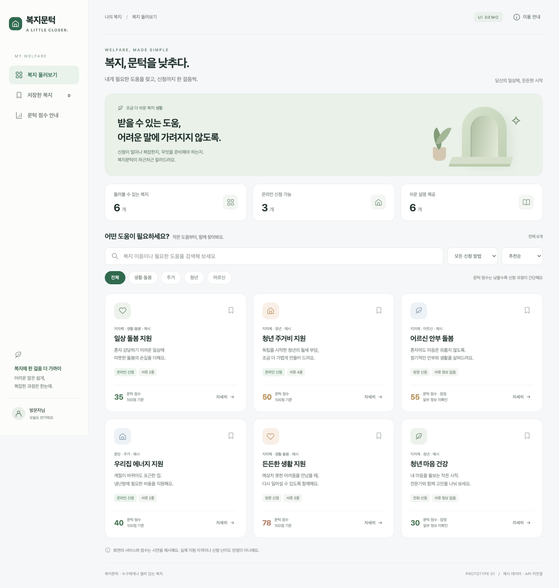
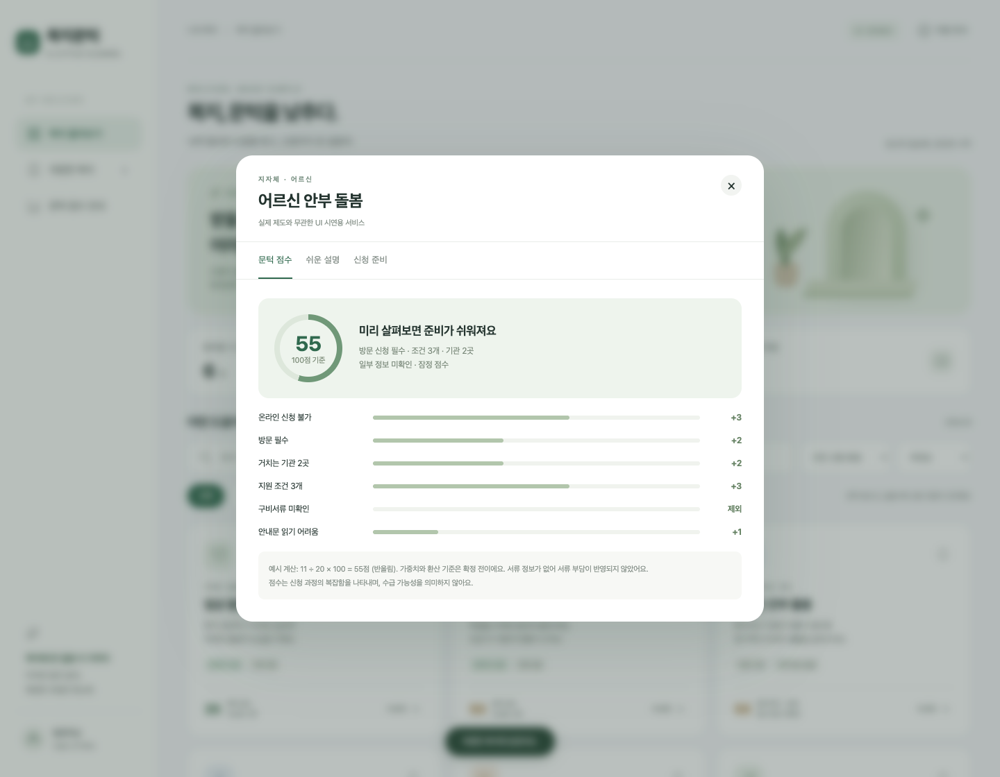
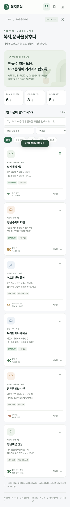

# 복지문턱 — 더 가까운 복지

복지서비스의 신청 절차를 비교하고, 어려운 안내문을 쉽게 이해하도록 돕는 데이터분석 프로젝트입니다.

> **개발 상태: UI 프로토타입** · 현재 코드는 HTML/CSS/JavaScript로 만든 데모입니다. 서비스 6개, 원문, 금액과 점수는 가상 예시이며 실제 복지서비스 분석 결과가 아닙니다. 실제 API 수집·AI 추출·쉬운 설명 생성·자동 검증은 향후 구현할 계획입니다.



## 1. 주제

**복지서비스 신청 과정의 복잡도를 설명 가능한 ‘문턱 점수’로 표현하고, 지원 조건과 신청 절차를 쉬운 설명으로 제공하기**

## 2. 주제 선택 이유

복지서비스는 지원대상, 선정기준, 신청방법이 긴 안내문으로 제공되는 경우가 있어 이용자가 필요한 정보를 찾고 비교하기 어렵습니다. 온라인 신청 여부, 방문 필요성, 조건과 서류의 수를 정리하면 신청 준비에 필요한 부담을 구체적으로 설명할 수 있다고 생각했습니다.

이 프로젝트는 복지 신청의 어려움을 비교하는 지표와 쉬운 설명을 함께 제공하는 것을 목표로 합니다. 문턱 점수는 수급 자격이나 선정 가능성을 판단하는 지표가 아닙니다.

## 3. 데이터 분석 내용

### 데이터 및 진행 상태

| 구분 | 내용 | 상태 |
| --- | --- | --- |
| 현재 데모 데이터 | 코드에 포함된 가상 복지서비스 6개 | UI 시연에 사용 |
| 수집 예정 데이터 | 중앙·지자체 복지서비스 API의 지원대상, 선정기준, 지원내용, 신청방법 | 실제 수집 코드·데이터 미포함 |
| 분석 항목 | 온라인 신청, 방문 필수, 기관 수, 조건 수, 서류 수, 안내문 난이도 | 지표 설계 단계 |
| 실제 분석 결과 | 분포·비교·추출 정확도 및 숫자 보존율 | 아직 산출하지 않음 |

### 분석 절차 — 구현 계획

1. 복지서비스 데이터를 수집하고 출처·수집일·서비스 식별자를 기록합니다.
2. 중복 및 결측을 확인하고 신청방법과 조건을 정리합니다.
3. 규칙 기반 방식과 언어 모델을 이용해 조건·서류·신청 절차를 추출합니다.
4. 항목별 가중합으로 문턱 점수와 그 근거를 산출합니다.
5. 서비스 유형별 점수와 신청방식의 분포를 비교합니다.
6. 50~100개 서비스를 사람이 검토한 정답표로 추출 결과를 평가합니다.
7. 쉬운 설명의 나이·소득·기간·금액이 원문과 일치하는지 검사합니다.

### 문턱 점수 — 현재 데모의 계산 방식

| 항목 | 가중치 |
| --- | ---: |
| 온라인 신청 불가 | +3 |
| 방문 필수 | +2 |
| 거치는 기관 수 | 기관당 +1 |
| 지원 조건 수 | 조건당 +1 |
| 확인된 구비서류 수 | 서류당 +0.5 |
| 안내문 읽기 어려움 | 0~3 |

```text
원점수 = 온라인 신청 불가 × 3 + 방문 필수 × 2
       + 기관 수 + 조건 수 + 확인된 서류 수 × 0.5 + 읽기 어려움
데모 점수 = min(100, 반올림(원점수 / 20 × 100))
```

가중치와 분모 20은 시연용 설정이며 검증된 척도가 아닙니다. 서류가 확인되지 않은 서비스는 해당 항목을 제외하고 ‘잠정 점수’로 표시합니다. 결측 때문에 낮아진 점수를 신청이 쉽다는 근거로 해석해서는 안 됩니다. 실제 분석 단계에서는 결측률과 가중치 변화에 따른 결과도 확인할 계획입니다.

## 4. 구현 기능

- 서비스명 검색, 분야·신청방법 필터, 문턱 점수 정렬
- 관심 서비스 저장 및 저장 목록 조회
- 문턱 점수의 항목별 근거 표시
- 미리 작성된 쉬운 설명과 가상 원문 비교
- 신청 준비 체크리스트와 서류 미확인 안내
- 데스크톱·모바일 반응형 화면

쉬운 설명은 현재 AI가 생성하지 않습니다. 신청서·위임장 자동 작성과 실제 신청 제출도 구현 범위에 포함되지 않습니다.

<details>
<summary>상세 화면 및 모바일 화면</summary>





</details>

## 5. 실행 방법 및 기술

저장소를 다운로드한 뒤 `index.html`을 브라우저로 열면 됩니다. 별도의 패키지 설치가 필요하지 않습니다.

로컬 서버로 실행하려면 저장소 폴더에서 다음 명령을 실행합니다.

```bash
python3 -m http.server 8000
```

브라우저에서 `http://localhost:8000`으로 접속합니다.

| 구분 | 기술 |
| --- | --- |
| 현재 구현 | HTML, CSS, JavaScript, 브라우저 localStorage |
| 데이터 분석 계획 | Python, 복지서비스 API, 규칙 기반 추출, 언어 모델 API |
| 앱 구현 계획 | Streamlit 검토 중 — 현재 코드는 Streamlit 앱이 아님 |

## 6. 프로젝트 계획서 및 발표자료

- [프로젝트 계획서 초안](docs/project-plan.md)
- 발표자료 PPT: **등록 예정** — 최종 PPTX를 `docs/presentation/`에 추가하고 링크를 연결합니다.

## 7. 시연 동영상 및 외부 URL

- YouTube 시연 영상: **등록 예정**
- 시연 가능한 외부 URL: **미배포**
- [90초 시연 구성안](docs/demo-script.md)

현재는 로컬 실행이 가능합니다. 외부 배포가 완료되면 실제 접속을 확인한 URL을 이 항목에 추가합니다.

## 8. 팀원 소개

실제 이름과 역할을 확인한 후 아래 표를 확정합니다. 아래 역할은 제안이며 확정된 분담이 아닙니다.

| 이름 | 담당 역할(안) | GitHub |
| --- | --- | --- |
| 확인 필요 | 데이터 수집·정제 | 확인 필요 |
| 확인 필요 | AI 추출·쉬운 설명·숫자 검사 | 확인 필요 |
| 확인 필요 | 수작업 정답표·분석 검증 | 확인 필요 |
| 확인 필요 | 화면 구현·발표 | 확인 필요 |

## 9. 저장소 구조

```text
.
├── README.md
├── index.html
├── .gitignore
└── docs/
    ├── project-plan.md
    ├── demo-script.md
    ├── submission-checklist.md
    ├── presentation/
    └── assets/
```

## 10. 제출 안내

대표 저장소: [DavidPark04/bokji-portfolio](https://github.com/DavidPark04/bokji-portfolio)

제출기한: **2026년 12월 1일(화) 24:00** (12월 2일 00:00).

팀 대표 저장소에 최종 코드와 자료를 반영한 뒤, 팀원은 본인 계정으로 Fork하여 **본인 GitHub 저장소 주소**를 제출합니다. [제출 체크리스트](docs/submission-checklist.md)에서 미완료 항목을 확인할 수 있습니다.
